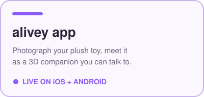
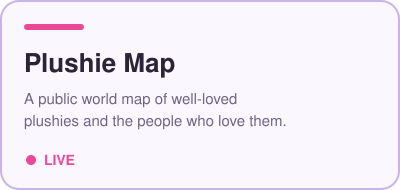
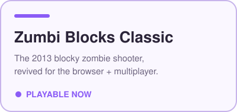
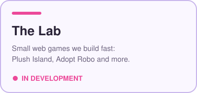
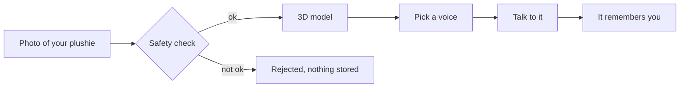

  

  <a href="https://alivey.ai"><b>alivey.ai</b></a> &nbsp;·&nbsp;
  <a href="https://plushies.alivey.ai"><b>Plushie Map</b></a> &nbsp;·&nbsp;
  <a href="https://zumbi-blocks-classic.vitosenic.com"><b>Play Zumbi Blocks</b></a> &nbsp;·&nbsp;
  <a href="https://github.com/alivey-ai/zumbi-blocks"><b>Source</b></a>

  
  
  

---

### What we make

<table>
  <tr>
    <td width="50%"></td>
    <td width="50%"></td>
  </tr>
  <tr>
    <td width="50%"></td>
    <td width="50%"></td>
  </tr>
</table>

Click a card to open it.

---

<b>How does a plushie come alive?</b> &nbsp;(click to expand)

 

1. **Snap** one photo of the toy you love.
2. A safety check runs before anything else happens.
3. We build a 3D version of *your* plushie, not a generic one.
4. Give it a voice and talk to it. It remembers what matters to you.

<b>Which alivey thing are you?</b> &nbsp;(a tiny quiz)

 

**Do you still have the plush toy from when you were small?**

Yes, it's right here.

 
You are an <b>alivey</b> person. Bring it to life: <a href="https://alivey.ai">alivey.ai</a>

Yes, but I'd love to show it to the world.

 
You belong on the <b>Plushie Map</b>. Pin yours: <a href="https://plushies.alivey.ai">plushies.alivey.ai</a>

No. I'm here to shoot blocky zombies.

 
Fair. <a href="https://zumbi-blocks-classic.vitosenic.com"><b>Play Zumbi Blocks Classic</b></a> in your browser.

<b>The Lab</b> &nbsp;(what we're tinkering with)

 

| Project | What it is | Status |
|---|---|---|
| **Plush Island** | A cozy social world where plushies hang out together | prototype |
| **Adopt Robo** | Eat scrap, grow bigger, outlast the other robots | prototype |
| **Zumbi Blocks Classic** | The 2013 original, rebuilt for WebGL + multiplayer | [playable](https://zumbi-blocks-classic.vitosenic.com) |

Zumbi Blocks was created by **AdrianKS** in 2013 and is revived here with his permission.
Check out his sequel, **Zumbi Blocks 2**, on Steam.

<b>Built with</b>

 

  
  
  
  
  
  

---

  alivey is for ages 13 and up. &nbsp;·&nbsp; Made with care in Ljubljana. &nbsp;·&nbsp; <a href="https://alivey.ai">alivey.ai</a>

